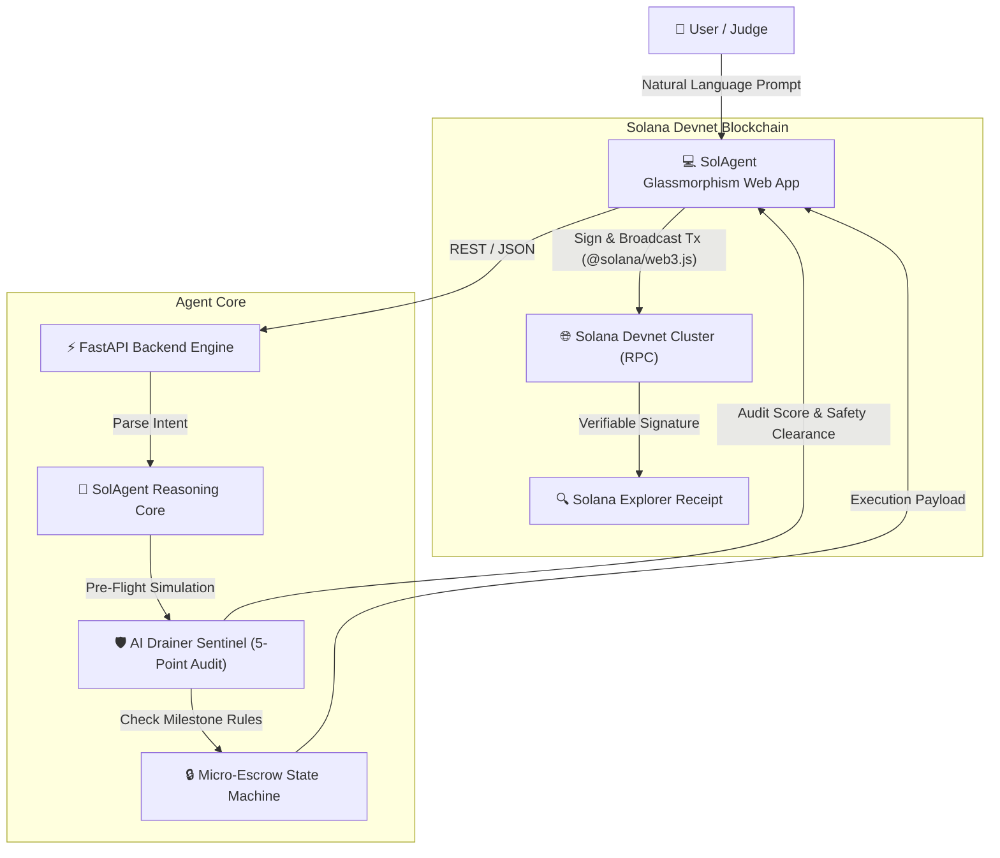

# ⚡ SolAgent — Autonomous Solana AI Copilot & Sentinel

[](https://solana.com)
[](https://python.org)
[](https://fastapi.tiangolo.com)
[](https://mlh.com)

> **SolAgent** is an autonomous AI financial copilot and drainer-prevention sentinel on Solana. It translates natural language directives into verified, audited, and cryptographically settled Devnet transactions and micro-escrows.

---

## 🏆 Hackathon Tracks Targeted
* **AI Track** (Primary): Autonomous on-chain AI agent with pre-flight risk simulation and intent resolution.
* **DeFi Track**: Micro-escrow state machine, automated bounty settlements, and Solana payment execution.
* **Top 3 Overall**: Complete zero-friction working product with real Explorer verification.

---

## 🌟 Key Features

1. **🧠 Natural Language Intent Engine**:
   - Understands commands like *"Transfer 0.05 SOL to community treasury with memo 'MLH Bounty'"* or *"Create milestone escrow of 0.25 SOL for passing CI/CD tests"*.
   - Generates step-by-step reasoning logs and extracts normalized transaction parameters.

2. **🛡️ AI Drainer Sentinel & Security Audit**:
   - 5-point bytecode & program inspection before any transaction is signed.
   - Detects unverified programs, balance drain percentages (>60% warning), authority freeze risk, and malicious phishing memo patterns.
   - Outputs an instant Safety Score (0–100%) and color-coded risk tier (`SAFE`, `CAUTION`, `CRITICAL_RISK`).

3. **🔒 Autonomous Micro-Escrow & Bounty State Machine**:
   - Locks funds into programmatic milestone escrows.
   - Releases funds autonomously once verification conditions or approvals are met.

4. **⚡ Verifiable Solana Devnet Integration**:
   - Works with **Phantom / Solflare** or **Instant 1-Click Devnet Burner Keypair** (zero extension required for judges!).
   - Verifiable transaction signatures with direct links to [Solana Explorer](https://explorer.solana.com/?cluster=devnet).

---

## 🏗️ Architecture Overview



---

## 🚀 Quickstart (Run in 30 Seconds)

### 1. Prerequisites
- Python 3.10+ (Python 3.12 recommended)
- Modern web browser (Chrome, Brave, Edge, Firefox)

### 2. Start Application
```bash
# Clone and enter directory
cd solagent

# Launch the app
python run.py
```

Open your browser at **`http://127.0.0.1:8000`**. The application auto-provisions a Solana Devnet burner keypair and displays your dashboard!

---

## 🧪 Try These Live Directives

Click any of the quick-action pills in the dashboard or type:
- `Transfer 0.05 SOL to 7xKXtg2CW87d97TXJSDpbD5jBkheTqA83TZRuJosgAsU with memo 'MLH Hackathon Winner'`
- `Create milestone escrow of 0.2 SOL for PR Review #42`
- `Run security scan and drainer audit on my wallet`
- `Release escrow escrow-mlh-9901 for verified bounty completion`
- `+1 SOL Faucet` (Requests airdrop from Solana Devnet faucet)

---

## 📂 Repository Structure

```
solagent/
├── backend/
│   ├── app.py              # FastAPI server & route handlers
│   ├── agent.py            # AI Reasoning & Intent Parsing Engine
│   ├── security.py         # AI Risk & Drainer Audit Sentinel
│   ├── escrow.py           # On-chain Escrow & Bounty State Machine
│   └── solana_rpc.py       # Solana RPC Client & Explorer Formatter
├── frontend/
│   ├── index.html          # Cyberpunk Solana Glassmorphism UI
│   ├── app.js              # Solana Web3.js integration & Controller
│   └── styles.css          # Solana neon styling & animations
├── docs/
│   ├── MLH_SUBMISSION.md   # Copy-paste Devpost / MLH form responses
│   ├── DEMO_VIDEO_SCRIPT.md# 2-minute word-for-word demo recording script
│   └── ARCHITECTURE.md     # In-depth architectural design
├── run.py                  # Single-command launcher
├── requirements.txt        # Dependencies
└── README.md
```

---

## 📜 License
MIT License. Built with ❤️ for the Major League Hacking (MLH) Solana Hackathon.

