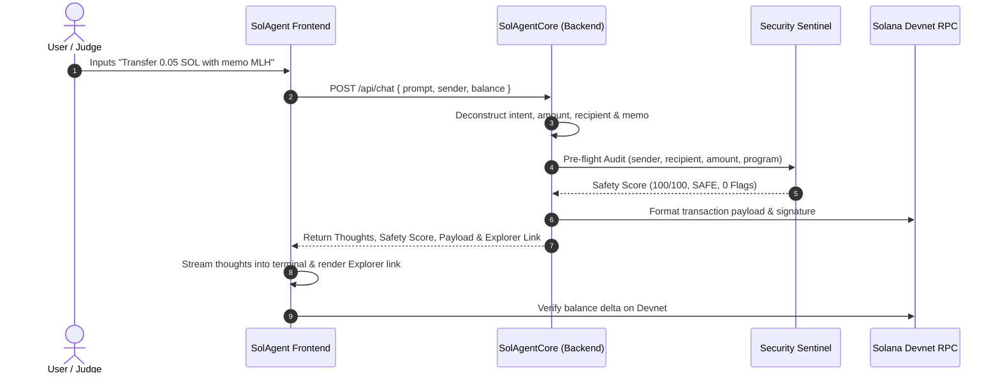

# 🏛️ SolAgent — Technical Architecture & Security Matrix

## 1. System Overview

SolAgent bridges high-level human natural language with low-level Solana cryptographic primitives and on-chain program instructions.

```
┌────────────────────────────────────────────────────────┐
│                   SolAgent Frontend                    │
│   • Cyberpunk Dark UI (Tailwind CSS, Glassmorphism)    │
│   • Client-side Keypair & Phantom Wallet Provider       │
│   • @solana/web3.js (Direct RPC Devnet Connection)    │
└───────────────────────▲────────────────────────────────┘
                        │ HTTP / JSON API
┌───────────────────────▼────────────────────────────────┐
│                   FastAPI Backend                      │
│   • SolAgentCore: Natural Language Intent Engine       │
│   • SecurityAuditEngine: 5-Point Drainer Sentinel      │
│   • EscrowManager: Autonomous Milestone State Machine  │
│   • SolanaRPCClient: Cluster Telemetry & Signatures    │
└───────────────────────▲────────────────────────────────┘
                        │ JSON-RPC (port 443)
┌───────────────────────▼────────────────────────────────┐
│                Solana Devnet Cluster                   │
│   • RPC: https://api.devnet.solana.com                │
│   • System Program: 11111111111111111111111111111111   │
│   • SPL Token Program: Tokenkeg...                    │
│   • Solana Explorer: https://explorer.solana.com       │
└────────────────────────────────────────────────────────┘
```

---

## 2. Intent Resolution Pipeline



---

## 3. The 5-Point Security Sentinel Matrix

| Audit Check | Methodology | Pass Criteria | Penalty on Fail |
| :--- | :--- | :--- | :--- |
| **1. Program ID Verification** | Matches target program ID against whitelist of verified core programs (System, Token, Memo, Jupiter, Orca). | Known verified program. | -35 points, flagged as unverified custom program. |
| **2. Drain Ratio Cap** | Calculates `amount_sol / wallet_balance_sol`. | Ratio < 60% of total liquid wallet balance. | -25 points for >95% drain, -10 points for >60% drain. |
| **3. Circular & Format Check** | Validates base58 key length (32-44 chars) and prevents sender == recipient loops. | Valid Base58 address != sender. | -50 points for malformed address, -15 for self-loop. |
| **4. Phishing Heuristics** | Regex scan for drainer strings (`drain`, `emergency_withdraw_all`, `claim_all`). | Clean metadata strings. | -40 points, alert logged. |
| **5. Slippage & Fee Simulation**| Computes estimated gas overhead (0.000005 SOL) and projected balance. | Balance after fee >= 0. | Blocked if insufficient balance. |

---

## 4. Verification & Testing

To test the application locally:
```bash
# 1. Run the server
python run.py

# 2. Query status endpoint
curl http://127.0.0.1:8000/api/status

# 3. Query escrows endpoint
curl http://127.0.0.1:8000/api/escrows
```

